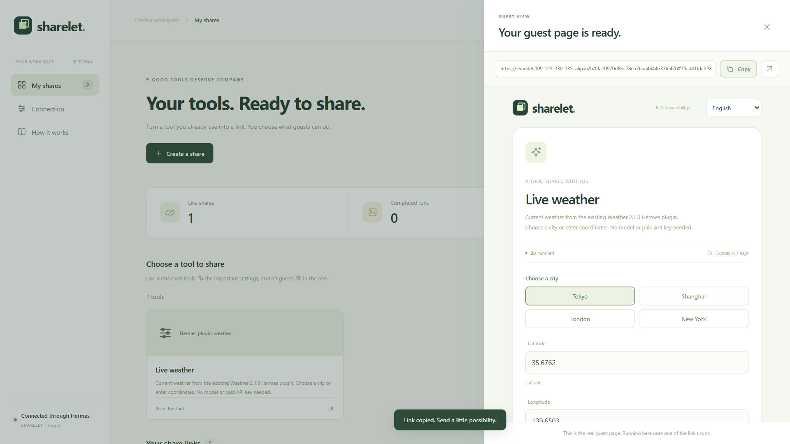
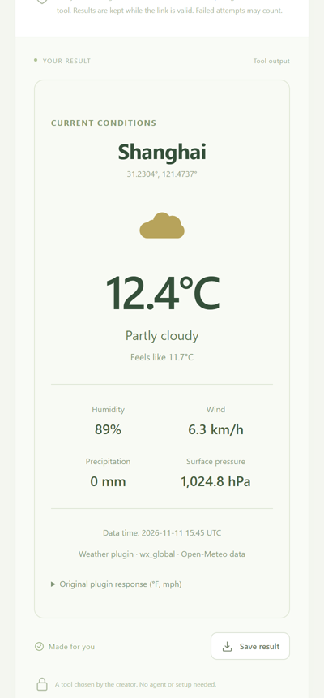

# Sharelet 0.5.2

**Your tools. A link anyone can use.**

Pick a tool you already use in Hermes, click **Create share link**, and send the link. Guests use the tool in their browser. They need no agent, account or API key. Stable addresses across reconnects are available with your own relay or fixed public address.

[简体中文](README.zh-CN.md) · [日本語](README.ja.md)





These screenshots show an explicitly configured relay. The default configuration uses raw tunnel links.

From the catalog: `hermes plugins install sharelet --enable`, or `hermes plugins install TANGBUDU/sharelet --enable`.

## Quick start

1. Extract the plugin archive into your Hermes profile's `plugins` folder and enable it:

   ```yaml
   plugins:
     enabled: [sharelet]
     entries:
       sharelet:
         mcp_allowlist: [my_tools]   # MCP servers you already use and trust
         settings:
           enabled: true
   ```

2. Start Hermes, ask it to run `sharelet_status`, and open the creator page it points to.
3. Choose a tool and click **Create share link**. Copy the link and send it.

Each link allows 20 runs for 7 days by default and can be closed at any time. **More settings** changes the run count (up to 1,000) and expiry (up to 30 days), renames the share, or fixes inputs guests should not change. Tools that may change data, send messages or cost money ask for one confirmation before the link is created; tools marked destructive cannot be shared.

The tool runs on your computer, so it must stay online. An optional self-hosted relay can show a "creator offline" page and retry when your computer returns.

## Public addresses and optional stable links

Sharelet opens a temporary Cloudflare address for guests only while you have a public link, and reconnects it automatically if it drops. **Relay routing is disabled by default:** links use the temporary address and must be copied again after it changes. No relay is contacted until you explicitly set one. For a stable link, run your own relay and set `relay_url`, or supply a fixed `public_origin`:

```
https://relay.example.com/h/<your host id>#<link token>
```

An explicitly configured relay receives your host's random ID, relay secret and current temporary address. The link token is after `#`, so it is absent from HTTP requests to the relay API. The relay's landing-page JavaScript handles that fragment and is trusted code: operate the relay yourself and control the code it serves.

Options, under `settings` in the plugin entry:

| Setting | Effect |
|---|---|
| *(default)* | No relay. Raw temporary tunnel links; no relay registration or heartbeat. |
| `relay_url: https://relay.example.com` | Explicitly opt into your own relay. Server code is in `relay_service/`. |
| `relay_url: ""` | No relay. Links use the temporary address directly and change after a reconnect. |
| `public_origin: https://my-pc.example.ts.net` | An address you run yourself for the guest port (for example `tailscale funnel 9272` or a Cloudflare named tunnel). No temporary tunnel or relay is used. |

Without a relay, the computer still has to be on for a link to work; nothing here hosts your tool elsewhere.

Upgrading from 0.5.1: restart Hermes after updating. The former automatic author-run relay is no longer used. Copy new raw links, or explicitly configure a relay you operate yourself. Link signing keys, run counts and expiry remain in your workspace.

## What Sharelet does on your computer

- **Local servers.** While Hermes runs, Sharelet serves the creator page on `127.0.0.1:9271` and guest pages on `127.0.0.1:9272`.
- **Public address.** When a public link is active, Sharelet downloads `cloudflared` **2026.10.7** from the exact official release URL and verifies its SHA-256 against the hard-coded platform pins in `tunnel.py`. Managed cached executables are checked again before launch. It forwards guests to the guest port only, and it stops when no public link is left. An explicitly supplied `cloudflared_path` is a creator-trusted installation, outside automatic download management.
- **Relay.** Off by default, with no author-run endpoint configured. Only when you explicitly set `relay_url` does Sharelet register a random host ID and secret with that relay and send its current tunnel address: every 60 seconds while online, otherwise an offline status every 10 minutes. The relay serves trusted guest-page JavaScript, so use a relay you operate yourself.
- **Tools.** When a guest uses a link, Sharelet runs that one tool through Hermes with the inputs the guest is allowed to change. You grant each tool. A tool that is not marked read-only needs a separate confirmation for every share.
- **Files.** Sharelet writes only to its own data folder: links, run records, results, and its signing keys.
- **Optional images.** The built-in image recipes are off until you set them up. They use either a key you enter in Sharelet, saved in its data folder with owner-only permissions, or your explicitly enabled Hermes-profile `OPENAI_API_KEY`, resolved through `agent.secret_scope.get_secret`. The profile scope is retained across HTTP, job and service-takeover threads. These recipes are the only part that calls `api.openai.com`.
- **Not included.** No telemetry, no self-update.

## Advanced

Everything below is optional.

Creating a link makes no model call. Running the selected tool uses **the creator's own connection**. The release contains no developer credentials, account or hosted execution endpoint. The interface is available in **English / 简体中文 / 日本語**; the browser remembers the choice, and switching keeps inputs intact.

### Existing Hermes plugins

Sharelet can expose a tool registered by an existing native Hermes plugin, in addition to MCP tools. In the active profile, explicitly grant the plugin, registered tool name, toolset and source directory:

```yaml
plugins:
  enabled: [weather, sharelet]
  entries:
    sharelet:
      native_tool_allowlist:
        - plugin: weather
          tool: wx_global
          toolset: weather
          source_dir: /absolute/path/to/weather
          presentation: weather
          bounds:
            lat: {minimum: -90, maximum: 90}
            lon: {minimum: -180, maximum: 180}
      settings:
        enabled: true
        generation_limit: 0
```

The original plugin must be loaded by Hermes. Sharelet checks the registered handler's source against the configured directory, binds its source fingerprint to the creator review, and calls the exact native tool through public `ctx.dispatch_tool`. Unknown native tools require the separate creator confirmation. Removing the grant blocks new runs. A zero image allowance is supported without configuring any model.

The real integration test uses the catalog's [Weather 2.1.0 plugin](https://github.com/FahrenheitResearch/hermes-weather-plugin/tree/d474493ef4ffeefabad9dbf0188f72bce3b47b67) and its unchanged `wx_global` handler. The weather panel displays that handler's returned data; raw JSON remains downloadable. No MCP server or substitute weather implementation is involved. Only this global-weather tool was tested; the plugin's optional radar/model/calculation dependencies were not provisioned. Backend-only plugins without a registered tool still need an adapter.

### Share a useful PDF tool

The optional [PDF workshop](examples/pdf_workshop/README.md) accepts guests' own PDF files, merges them in order, extracts or reorders pages, or performs lossless compression. Guests download the processed PDF directly. It runs the creator's local pypdf tool over a real MCP connection, without a model or paid API. This adds capability-scoped PDF uploads and downloads; standard text and image tools remain available.

### Permission Canvas adapter example

The optional [Permission Canvas playground](examples/permission_canvas/README.md) wraps an installed Permission Canvas backend as a narrow MCP tool. Guests can test allowed, read-only, approval-required and hidden controls in a fictional workspace. Decisions and screenshot/text redaction run through the original plugin; no native desktop or model is connected. Sharelet displays the resulting masked screenshot and execution receipt. This demonstrates a reviewed adapter, rather than automatically publishing an entire desktop plugin.

### Try it locally

Python 3.11+ is recommended. Built-in text tools run with the standard library:

```bash
python app.py --mode local
```

Open the private URL in `.state/owner-entry.txt`, choose **Text cleanup** or **Reading time** and click **Create share link**. For a link that only works on this computer, tick **Only on this computer** under **More settings**. No image key is needed. Relays are disabled by default; add `--relay-url https://relay.example.com` to use your own relay, or `--public-origin https://...` for your own address.

A public link opens a guest-only public address automatically. The connector version and SHA-256 values are pinned in `tunnel.py`. Linux AMD64/ARM64 and Windows AMD64 use their upstream executables. Upstream publishes no native Windows ARM64 executable: Windows 11 ARM64 selects the official Windows AMD64 asset with the same pinned digest, using OS x64 emulation. This compatibility path has selection/checksum tests, not an ARM64 hardware test. Other platforms can supply a creator-trusted `--cloudflared` executable.

On Windows, `Start-Sharelet.ps1` opens the prepared development workspace if present, or starts a local workspace. Its private `.preview-*-access.json` files are excluded from the release.

### Supported tools

Sharelet supports at most eight scalar input fields, strings up to 500 characters and bounded text/JSON output. Reviewed file adapters can mark a scalar field with `format: sharelet-pdf-uploads` to accept capability-scoped PDF uploads and return a validated local PDF receipt. General arrays, nested objects, arbitrary host paths, streaming output and remote media are not supported. Unsupported tools remain visible with a reason and cannot be published. Tool names, input contracts and current grants are rechecked before admission; changed or unavailable tools require review before a new run is charged.

### Install in Hermes

Extract the plugin archive into the chosen Hermes profile's `plugins` directory, so `sharelet/plugin.yaml` exists. Preserve other settings in that profile's `config.yaml`:

```yaml
plugins:
  enabled: [sharelet]
  entries:
    sharelet:
      mcp_allowlist: [my_tools]
      settings:
        enabled: true
        port: 9271
        guest_port: 9272
        execution_limit: 10000   # lifetime safety ceiling for all links together
        generation_limit: 30     # image attempts, if image recipes are set up
```

Replace `my_tools` with a server already configured and trusted in your own Hermes profile. Start Hermes and call `sharelet_status`. It returns the creator-entry **file location**, without returning its credential. The SDK owns the storage directory name; use that exact location rather than guessing `plugin-data/sharelet`.

The catalog uses the published `hermes_cli.config` and `tools.registry` APIs. Generic calls preserve the exact registered MCP tool name and use public `ctx.dispatch_tool`; reviewed image recipes use public `ctx.call_mcp`. Both paths retain the current profile's explicit server grant.

For the included no-model MCP example, install `requirements-preview.txt` in its Python environment, add `sharelet_public` to `mcp_allowlist`, and configure:

```yaml
mcp_servers:
  sharelet_public:
    command: /absolute/path/to/python
    args: [/absolute/path/to/plugins/sharelet/demo_mcp.py]
    trust: full
    lazy: false
```

### Existing MCP connections without Hermes

Install the pinned SDK in the environment running Sharelet:

```bash
python -m pip install -r requirements-preview.txt
python app.py --mode local
```

In **Connection**, enter the absolute path to an existing MCP configuration, inspect its server names, and explicitly select the servers to connect. Their configured programs may start. Sharelet stores the source path and selected names, without copying credentials.

Supported configurations include JSON `mcpServers`/`servers`, TOML `mcp_servers`, and YAML `mcp_servers` when PyYAML is installed. Transports are stdio and Streamable HTTP. Remote HTTP requires HTTPS; loopback HTTP is supported. Environment references and common Codex bearer/header environment settings are supported. OAuth sign-in, legacy SSE and platform-specific configuration extensions are not implemented.

### Other agents: MCP draft controller

Register `sharelet_mcp.py` as a stdio MCP server in a compatible client:

```json
{
  "mcpServers": {
    "sharelet": {
      "command": "/absolute/path/to/python",
      "args": ["/absolute/path/to/sharelet/sharelet_mcp.py"]
    }
  }
}
```

It exposes tool discovery, share requests, share listing, revocation and connection status. `sharelet_create_share` prepares a pending request and returns no active link. Open the private creator-entry file, review the request and approve it there. Pending requests expire after one hour; an approved link's lifetime starts at approval. The controller can revoke only shares created through its approved requests. Its service starts locally when needed and survives the MCP client exiting. The default portable workspace is `%LOCALAPPDATA%/Sharelet` on Windows or `$XDG_DATA_HOME/sharelet` (otherwise `~/.local/share/sharelet`) on Linux.

To attach to an existing standalone or Hermes workspace, add `--data-dir /exact/workspace/data/directory --no-auto-start`. `--local-only` prevents that controller from requesting public shares. The controller can use the tools connected to that workspace; it does not automatically inherit every capability or the model subscription of its host agent. The client's own write approval rules still apply, in addition to Sharelet's creator approval.

Creator and agent APIs use different credentials. The MCP controller never reads or returns the creator credential. This is an application boundary, not an OS sandbox: an agent separately given arbitrary shell/filesystem access under your own account can access your private files outside this controller.

**Upgrading from 0.4:** restart the Sharelet service and MCP controllers, then reopen the regenerated private `owner-entry.txt`. The new creator key is stored separately in `owner-v2.key`; legacy `owner.key` is never accepted. Existing unknown/write shares without the new review must be recreated and approved.

Actual client testing and its approval limitations are recorded in [VALIDATION.md](VALIDATION.md). MCP compatibility is not a claim that every agent and every configuration has been tested.

### Optional images

Standalone mode includes three fixed recipes. Image settings appear in the creator page only once an image recipe is available. In **Connection → Optional image provider**, enter the workspace's own OpenAI key, or explicitly enable the current Hermes profile's key when the SDK makes it available. `OPENAI_API_KEY` is declared as optional in `plugin.yaml` and resolved through `agent.secret_scope.get_secret`, with the owner's profile captured for background workers. Missing or unbound multiplex scopes fail closed. Standalone installs without Hermes can enter a workspace key; they do not fall back to the process environment. Other credential files are not read. Creator state returns neither the key nor a credential-derived identifier. For Hermes, add `sharelet_images` to `mcp_allowlist` and configure the included adapter in the same profile:

```yaml
mcp_servers:
  sharelet_images:
    command: /absolute/path/to/python
    args: [/absolute/path/to/plugins/sharelet/demo_image_mcp.py]
    env:
      SHARELET_PROVIDER_CONFIG: /exact/sdk/data/directory/provider.json
    trust: full
    lazy: false
    timeout: 180
```

Restart Hermes after adding the server. The recipes fix GPT Image 2, low quality, one 1024 × 1024 PNG and creator art direction. Guests supply only a character description. A custom image adapter must implement the reviewed recipe schema and local image-receipt protocol; connecting an arbitrary image tool does not automatically make it a supported image recipe.

### Allowances, privacy and public access

The link allowance is **shared by all holders**, not per person. Behind the per-link counts, a workspace has a lifetime safety ceiling of 10,000 admitted executions and 30 admitted image requests, set with `execution_limit` and `generation_limit`. Both persist across restarts; these are attempt counts, not daily or dollar budgets, and recorded usage is never reset. An image also counts against the total execution allowance. Invalid input, missing providers and unavailable or changed tool contracts are rejected before charging. Admitted failures and interrupted requests count. Uncertain requests are never automatically resubmitted.

Review each tool's behaviour, output and usage costs before publication. MCP annotations are advisory: explicitly destructive tools are blocked; missing or non-read-only metadata requires a separate confirmation of that exact tool for each share. Native Hermes may omit upstream annotations, so unknown tools take this stricter path. A read-only tool can still disclose private data or incur a charge. Fix sensitive account settings and publish only output suitable for anyone holding the link. Sharelet management tools cannot be shared.

Inputs go to the creator's selected tool and any provider it uses. Sharelet stores input fingerprints, execution state and timings, without raw guest inputs or provider credentials in its activity log. Tool text/JSON and generated PNGs are cached on the creator's host for delivery and purged after revocation/expiry. Anyone with a link and result URL can access that result while valid; downloaded output cannot be recalled. A run already started can finish and count after revocation.

Both listeners bind to loopback. Public access forwards only the guest listener; creator and agent APIs are disabled there even with valid credentials. Rate limiting uses verified share identities and a service ceiling, after input validation, so malformed inputs and the tunnel's loopback IP do not merge or poison unrelated link allowances. HTTP concurrency, background queues and native RPC slots are bounded. Native calls stop waiting after 180 seconds; their remote work may still finish, so an uncertain result is marked interrupted and never retried automatically.

Queued requests recheck the link and reviewed tool before dispatch. A request proven not to have reached the tool is refunded; revocation cannot cancel work already sent to a remote tool. JSON reception has a separate pool of 8 per listener, capped at 2 per link and 10 seconds per body, so a slow sender cannot occupy every guest connection.

Cloudflare Quick Tunnels provide the temporary address. It opens while at least one public link is active, closes when none is, and reconnects with backoff after a failure. With the relay, links keep their address across reconnects and restarts; without it, copy a fresh link after reconnecting. Quotas and revocation persist independently. This is not permanent hosting or an uptime guarantee.

## Verification

```bash
python -m pip install -r requirements-preview.txt
python -m unittest discover -s tests -p "test_*.py" -v
node --check web/app.js
node --check web/i18n.js
node --check web/forms.js
node --check web/owner.js
node --check web/guest.js
```

See [VALIDATION.md](VALIDATION.md) for real Hermes and provider runs, the actual MCP client test, transport checks, a bounded soak, process-crash recovery and remaining limits. Development probes and evidence are in the full source package; the installable archive uses an explicit allowlist that excludes tests, development scripts, state, credentials and private access links.

- [Hermes public plugin APIs](https://hermes-agent.nousresearch.com/docs/developer-guide/plugins/)
- [Model Context Protocol](https://modelcontextprotocol.io/docs/develop/build-client)
- [OpenAI image generation](https://developers.openai.com/api/reference/python/resources/images/methods/generate)
- [Cloudflare Quick Tunnels](https://developers.cloudflare.com/tunnel/get-started/quick-tunnels/)

MIT License.
